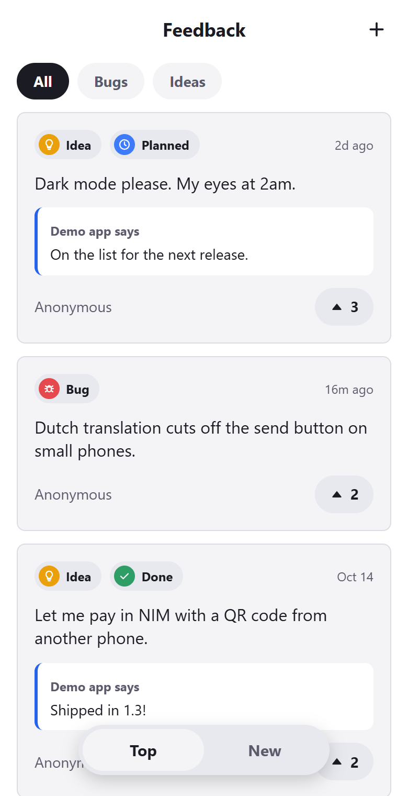
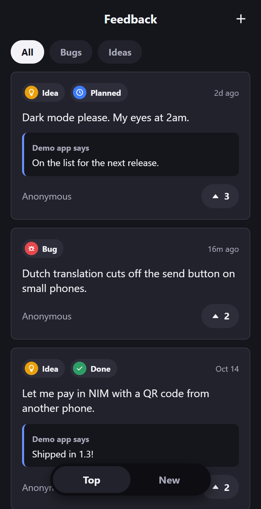
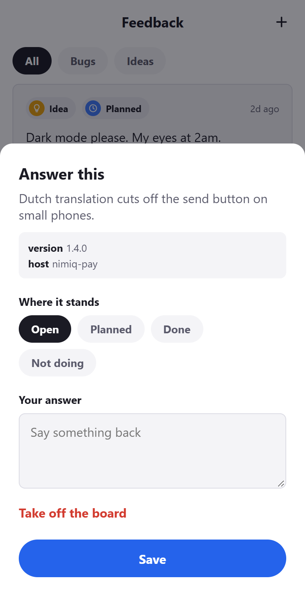
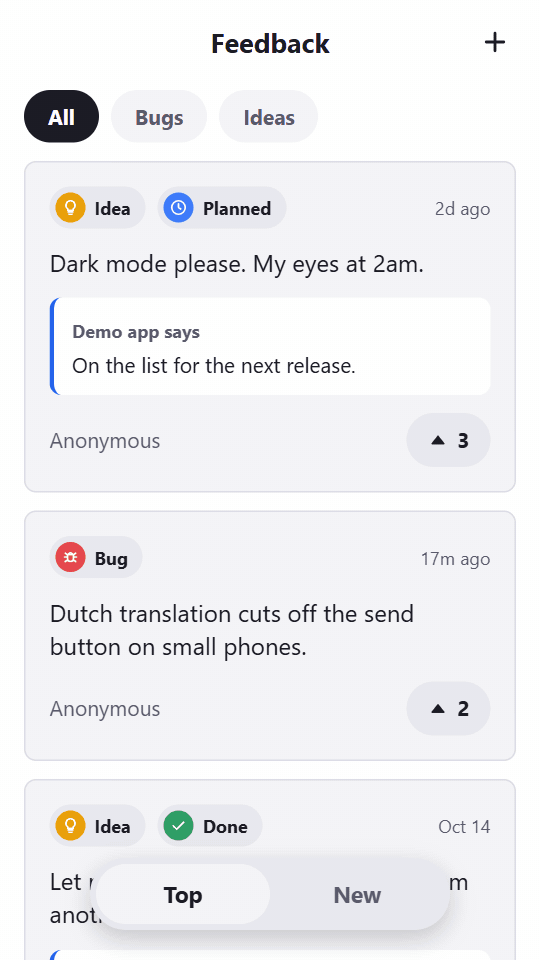

# PleaseNoBugs

**Bugs and ideas, straight from your users. By [Shitti](https://shitti.me).**

A feedback board you drop into your Nimiq mini app. Your users post what is
broken and what is missing, second each other's wishes, and you answer them in
one place, without asking anybody to send you an email.

<p>
  
  
  
</p>

> **Status: not yet published.** The server and the widget work and run
> [Shitti](https://shitti.me)'s board; npm packages and the Railway button
> follow.
> This is a community tool, not an official Nimiq product.

## What it does



- **Bugs and ideas**, picked before typing, because the two want different words.
- **One vote per wallet**, so the most wanted thing rises to the top.
- **Lookalikes while typing**: posts that resemble yours appear under the field,
  so people second the existing wish instead of writing it a fifth time.
- **Your answer under every post**: Planned, Done, Not doing, plus one reply.
- **Bug reports carry context** you choose, like your app's version, shown to
  you and nobody else.
- **Anonymous by default.** A name shows only if the author turns it on, and a
  wallet address is never shown to anyone.
- **Login is the Nimiq wallet your users already have.** No accounts, no email.
- **Follows the phone**: light or dark, English, Dutch or German, and your
  accent colour.

<br clear="right">

## Get it running

Three steps, about ten minutes, no command line.

### 1. Start your server

*(The Deploy on Railway button arrives when this repository is public.)*

Click the button and fill in three fields:

| Field | What to put there |
|---|---|
| `PNB_PROJECT_NAME` | What your users call your app. Your answers are signed with it. |
| `PNB_PROJECT_ORIGINS` | Where your app runs, e.g. `https://my.app`. Several are fine, separated by commas, like `https://my.app,http://localhost:5173` to try it while developing. |
| `PNB_PROJECT_OWNER` | The `NQ..` address you will answer with. Whoever signs in with this wallet is the owner. |

Railway builds the server, gives it a disk for the posts and a web address.
When it is up, open **Deploy Logs** and copy two things:

```
[pleasenobugs] created project "My app". Project id: k3v9q2xw7m
```

the **project id** from that line, and the **web address** of the service
(Settings → Networking, something like `https://pleasenobugs-production-1234.up.railway.app`).

### 2. Paste one line into your app

```html
<script src="https://unpkg.com/pleasenobugs"></script>
<please-no-bugs project="k3v9q2xw7m" server="https://pleasenobugs-production-1234.up.railway.app" mode="floating"></please-no-bugs>
```

That puts a small button in the corner that opens the board. Inside Nimiq Pay
it signs with your user's wallet by itself. To place it in your own page, open
it from your own menu, give it your colours or let people sign from a browser
wallet, see [the widget's README](packages/widget).

### 3. Answer

Open your app with your own wallet, open the board and tap **Sign in with your
wallet** at the bottom. Every post now opens when you tap it: set where it stands, write a
reply, or take it off the board.

## Your server, your data

You run your own PleaseNoBugs server, so your users' feedback never leaves
infrastructure you control. Nobody else, the makers included, holds it.

Railway is the quickest start, not a requirement. The server is one container
and every post is in one file, `pleasenobugs.db`, so you can run it wherever
you like and move by copying that file.

| Where | What you depend on | Good for |
|---|---|---|
| **Railway**, as above | Railway | No command line. About $1 to $1.50 a month. |
| **A backend you already have** | Nothing new | Apps with a Node server: `npx @pleasenobugs/server`, or mount it into Express. See [packages/server](packages/server). |
| **Your own server** with Docker (a VPS, or Coolify on one) | Whoever rents you the machine, and you can switch | A few euros a month for a small VPS, with room for other things. |
| **Your own hardware** (a Raspberry Pi, a NAS) | Your internet connection and a domain name | Depending on as little as possible, if you can keep it switched on. |

### With Docker

The image is `ghcr.io/lennylenders/pleasenobugs`, for Intel/AMD and ARM.
[`docker-compose.yml`](docker-compose.yml) runs it with
[Caddy](https://caddyserver.com) in front, which gets the HTTPS certificate
by itself. You need a domain name pointing at the machine and ports 80 and 443
open.

Put the compose file in an empty folder with a `.env` file next to it:

```
PNB_DOMAIN=feedback.my.app
PNB_PROJECT_NAME=My app
PNB_PROJECT_ORIGINS=https://my.app
PNB_PROJECT_OWNER=NQ07 ...
```

The `PNB_PROJECT_*` fields are the same three as on Railway. Then:

```bash
docker compose up -d
docker compose logs pleasenobugs
```

The log has the project id; the server is `https://` plus your `PNB_DOMAIN`.
Update with `docker compose pull && docker compose up -d`.

If your platform already gives you HTTPS (Coolify, a Cloudflare Tunnel to a Pi
at home), remove the `caddy` service and point the platform at `pleasenobugs`
on port 8787.

## Telemetry

Once a day your server sends us each project's **name** and **four numbers**:
how many bugs and ideas it has, and how many of each are done. That is how we
know the tool is useful. Never post text, wallet addresses, names of people or
votes. It says exactly this in its log when it starts, and
`PNB_TELEMETRY=off` switches it off.

## Packages

| Package | What it is |
|---|---|
| [`@pleasenobugs/core`](packages/core) | Types, rules, the login message and the lookalike matcher. No dependencies; used by everything else. |
| [`@pleasenobugs/server`](packages/server) | The API, with pluggable storage (memory and SQLite now, Postgres next). |
| [`pleasenobugs`](packages/widget) | The `<please-no-bugs>` web component and the headless client it is built on. |

The API itself: [docs/api-v1.md](docs/api-v1.md). Why things are the way they
are: [docs/decisions.md](docs/decisions.md).

## Try it locally

```bash
npm install
npm run build
npm run demo -w pleasenobugs
```

Opens a demo board on http://localhost:5180 with three test wallets, so every
state can be tried in a desktop browser without a phone.

## License

MIT
